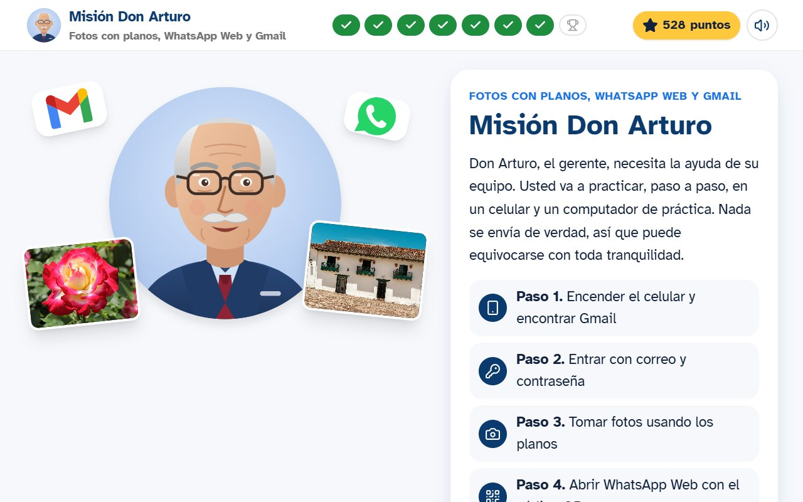
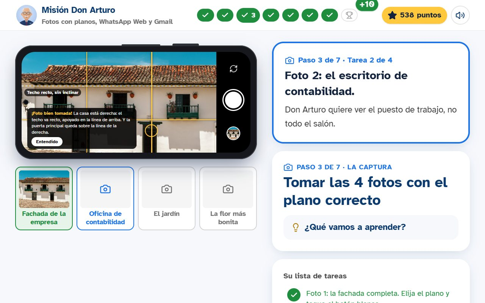
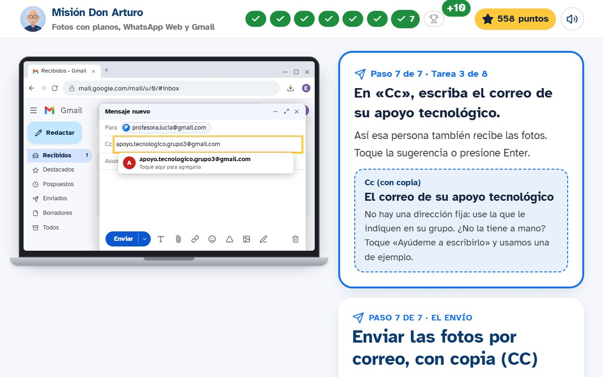
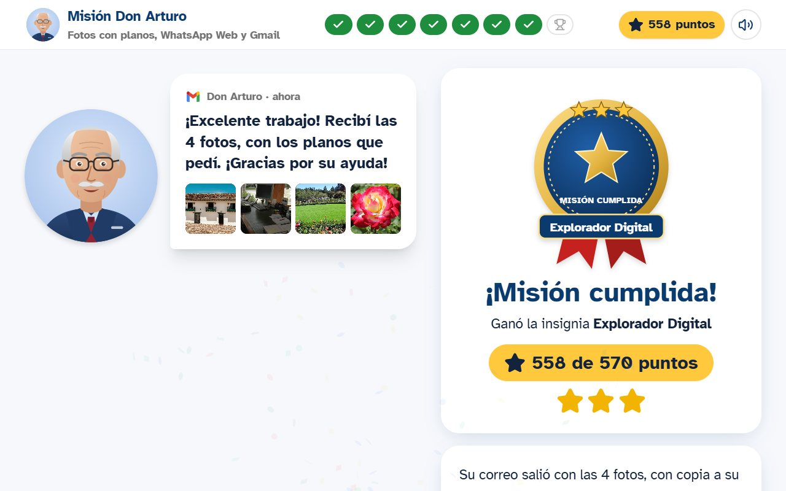
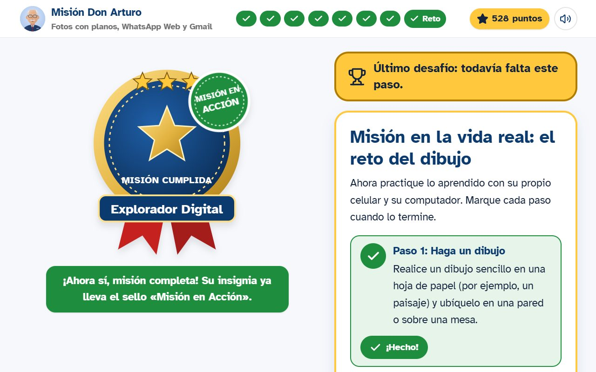
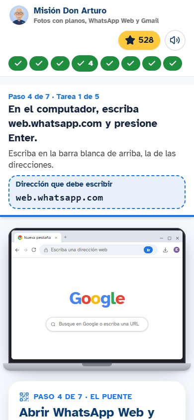

<picture>
  <source media="(prefers-color-scheme: dark)" srcset="assets/mys-logo-blanco.png">
  
</picture>

# 📸 Misión Don Arturo

### Un ejercicio práctico donde el estudiante toma fotos, las pasa al computador y las envía por correo, en un celular y un computador simulados, sin miedo a equivocarse

**MyS SinergiaaS**: Consultoría y Tecnología
*Automatiza. Escala. Vende.*

`En producción` · `Marca blanca` · `Sin registro` · `Sin instalación` · `Certificado en PDF` · `Celular y computador`

---

## El problema

Enviar una foto por correo parece fácil hasta que uno lo intenta por primera
vez: encender el celular, entrar a Gmail, tomar la foto bien encuadrada,
pasarla al computador por WhatsApp Web, encontrarla en Descargas, adjuntarla
y acordarse de la copia. Son siete destrezas distintas, y en un aula real
cada error le cuesta tiempo al grupo y confianza a quien se equivoca.

## La solución

**Un encargo, siete pasos y un celular y un computador de práctica.** Don
Arturo, el gerente de una distribuidora, pide cuatro fotos de la empresa. El
estudiante las toma, las pasa al computador y las envía por correo, como lo
haría en la vida real, pero en un entorno donde nada se envía de verdad.

### Cada foto enseña un plano y la regla de los tercios
Fotos reales, no dibujos. El estudiante elige el plano general, medio o
primer plano según lo que pide Don Arturo, y al acertar la cámara se detiene
a mostrar por qué la foto quedó bien tomada: el techo recto y la puerta sobre
una línea de los tercios.

### Gmail como es, con copia incluida
Una réplica fiel de Gmail en el computador: Para, **Cc**, Asunto, mensaje y
adjuntos. Las direcciones no son fijas: cada grupo usa la de su profesor y
la de su apoyo tecnológico, y si alguien se equivoca recibe una pista amable
y lo que debe tocar se ilumina.

### Puntos, estrellas y un certificado que se descarga
Cada acierto suma puntos y cada pregunta de repaso premia acertar a la
primera. Al final el estudiante escribe su nombre y descarga su certificado
en PDF, con las competencias logradas, y su insignia como imagen.

### Y una misión en la vida real
La práctica no termina en la pantalla. Una hoja aparte propone el reto del
dibujo: tomar tres fotos reales con los planos aprendidos y enviarlas por
correo, con copia, junto al certificado. Al cumplirlo, la insignia recibe el
sello «Misión en Acción».

---

## Lo que lo hace distinto

| | |
|---|---|
| 🎯 **Una historia, no un cuestionario** | Hay un jefe, un encargo y un correo de respuesta al terminar. |
| 📱 **Celular y computador de verdad** | Encendido, Gmail, cámara, WhatsApp, código QR, Descargas y Gmail en el PC, con fotos reales. |
| 🧭 **Ayuda que no regaña** | Pistas amables, lo que hay que tocar brilla y un botón «Ayúdeme a escribirlo». |
| 🧓 **Pensado para quien empieza** | Letra grande y fácil de leer, trato de usted y una tarea a la vez. |
| 🏆 **Gamificación que motiva** | Puntos, estrellas, insignia, certificado en PDF y un reto real con sello. |
| 🏷️ **Marca blanca** | Sin logos de terceros: cada institución la usa con su propio nombre. |

---

## Para quién

- **Programas de inclusión digital** de alcaldías, cajas de compensación,
  bibliotecas y fundaciones.
- **Docentes y formadores** que enseñan herramientas digitales básicas.
- **Empresas** que necesitan que su equipo envíe evidencias fotográficas
  por correo de forma correcta.

---

## Probarlo

No se instala nada. No hay registro. Se abre el enlace y se practica:

### **→ [las-fotos-de-don-arturo.vercel.app](https://las-fotos-de-don-arturo.vercel.app)**

---

## Modalidades de implementación

| Modalidad | Para quién |
|---|---|
| **Uso directo** | La herramienta pública, tal como está, abierta para cualquier aula. |
| **Marca blanca** | El nombre de su institución en el certificado y su propio dominio. |
| **Implementación a la medida** | Otras destrezas digitales enseñadas con la misma dinámica. |
| **Taller facilitado** | La experiencia completa, dirigida en su institución por MyS SinergiaaS. |

Para cotizar cualquiera de ellas: **[hablemos por WhatsApp](https://wa.me/573148788974)**.

---

## ⚖️ Aviso legal y comercial

> **Este repositorio es una exhibición de portafolio.**
>
> Publica el **resultado** del producto (qué resuelve, cómo se usa y qué
> entrega) con fines comerciales y de demostración de capacidad técnica.
> **No contiene el código fuente de la aplicación.**
>
> El código fuente, el contenido pedagógico y el diseño de la dinámica son
> **propiedad intelectual exclusiva de MyS SinergiaaS**. No se distribuyen,
> licencian ni publican bajo ninguna licencia de código abierto.
>
> Gmail, WhatsApp y Google son marcas de sus respectivos dueños; la
> simulación es educativa y no está afiliada a ellos. Las fotos son de
> Wikimedia Commons: casa en la Plaza Principal de Villa de Leyva
> (Foturcolombia, CC BY 3.0, recortada); escritorio GX-226 (Palm Beach Police
> Department, dominio público); «Rose Garden Lawn» (daryl_mitchell,
> CC BY-SA 2.0); «Rosa 'Double delight'» (Arashiyama, CC BY-SA 3.0).
>
> El acceso público se ofrece para evaluación, demostración y uso en el aula.
> Su uso comercial, reventa, ingeniería inversa o incorporación a un producto
> de terceros requiere acuerdo escrito previo.
>
> © 2026 MyS SinergiaaS. Todos los derechos reservados.

---

## Hablemos

**Mac Eduardo Sáenz Martínez**
Dirección de Proyectos · Arquitectura de Soluciones · Transformación Digital
Valencia, Córdoba (Colombia)

